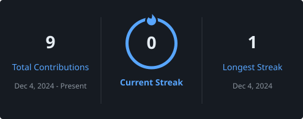

<!-- ===================== HEADER ===================== -->
<p align="center">
  
</p>

<p align="center">
  
</p>

<p align="center">
  
  
  
  
  
</p>

<!-- ===================== ABOUT ===================== -->
## 👨‍💻 About Me

```python
class SampadSekharPanigrahy:
    role        = "3rd year B.Tech student 🚀"
    education   = "Computer Science & Engineering — AI & ML specialization"
    passions    = ["Artificial Intelligence", "Machine Learning", "Problem Solving"]

    currently   = "Building my first projects and starting with open source"
    learning    = ["Python", "Machine Learning", "Git & GitHub", "DSA"]
    collab_on   = ["Beginner-friendly open-source projects", "AI/ML mini projects"]
    ask_me      = ["C", "Python"]
    fun_fact    = "Every big project starts with a small commit ⚡"
```

<!-- ===================== CONNECT ===================== -->
## 🌐 Connect with Me

<p align="center">
  <a href="https://github.com/sampadpanigrahy" target="_blank" rel="noreferrer"></a>
  <!-- LINKEDIN: <a href="https://www.linkedin.com/in/YOUR-ID" target="_blank" rel="noreferrer"></a> -->
  <!-- LEETCODE: <a href="https://leetcode.com/YOUR-ID" target="_blank" rel="noreferrer"></a> -->
  <!-- GMAIL: <a href="mailto:YOUR-EMAIL"></a> -->
</p>

<!-- ===================== PROJECTS ===================== -->
## 🚀 Projects

<table>
<tr>
<td width="50%" valign="top" align="center">

### 💻 C Projects

My first programs in C, written while learning the basics.


<a href="https://github.com/sampadpanigrahy/C-PROJECTS"></a>

</td>
<td width="50%" valign="top" align="center">

### 👁️ Eye Blinker

A Python project.


<a href="https://github.com/sampadpanigrahy/eye-blinker"></a>

</td>
</tr>
</table>

<p align="center"><i>More projects coming soon 🚧</i></p>

<!-- ===================== STACK & STATS ===================== -->
## 🛠️ Tech Stack

**Programming Languages**

<p align="left">
  
</p>

**Tools**

<p align="left">
  
</p>

## 📌 GitHub Overview

<p align="center">
  
</p>

<p align="center">
  
  
</p>

## 📈 Contribution Activity

<p align="center">
  
</p>

## 📊 GitHub Analytics

<p align="center">
  
  
</p>

<p align="center">
  
</p>

<p align="center">
  
</p>

<p align="center">
  
</p>
